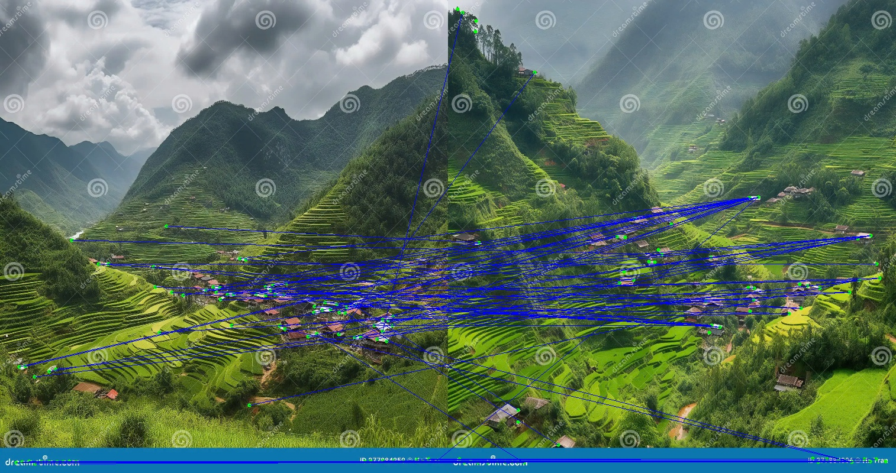
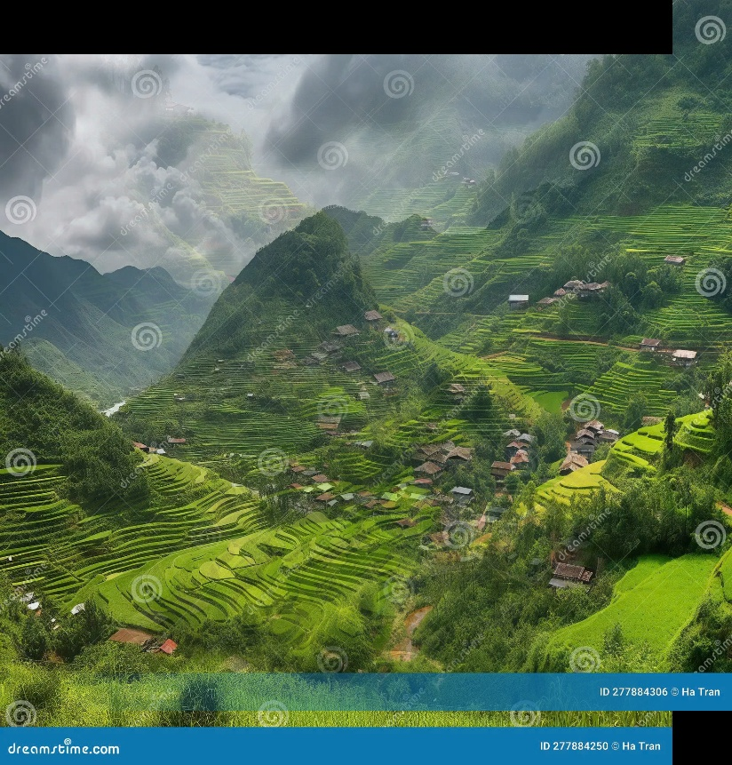

# Computer Vision with OpenCV

Computer-vision coursework from **CPV301 – Computer Vision** at FPT University: a dual-camera image-stitching final project built from scratch, plus lab notebooks covering classical image-processing algorithms.

## Final project — Dual Camera Stitching

[`dual-camera-stitching/`](dual-camera-stitching) stitches two overlapping camera views into one panorama, either from a live dual-camera feed or from static images. Every step of the pipeline is implemented by hand; OpenCV is used only for image I/O and basic geometric operations.

```
Input images → Feature detection → Descriptor extraction → Feature matching → Alignment → Blending → Panorama
```

| Component | Technique |
|-----------|-----------|
| `FeatureDetector` | Harris corner detection with Gaussian pre-blur and spatial-hashing non-maximum suppression (O(n)) |
| `DescriptorExtractor` | 24×24 patch descriptors (576-D), z-score normalized for illumination robustness |
| `FeatureMatcher` | Normalized cross-correlation with cosine-similarity fallback and ratio test |
| `RANSACHomography` | 4-point RANSAC with Direct Linear Transform and early termination |
| `ImageStitcher` | Translation-based alignment, linear blending in the overlap region, vertical axis alignment, edge-mirroring fill |
| `DualCameraStitcher` | Real-time camera mode, static-image mode and a sample test mode |

**Results on the sample pair** (`img/left.jpg`, `img/right.jpg`, 800×757 px): 79 / 64 corners detected, 76 matches, 690 px overlap, 824×861 px output canvas, under 2 s per pair and over 90 % success on well-textured image pairs.

| Feature matches | Stitched panorama |
|:---:|:---:|
|  |  |

### Run

```bash
pip install -r requirements.txt
cd dual-camera-stitching
python main.py
# 1 = real-time dual camera (q to quit, s to save)
# 2 = stitch two image files
# 3 = run on img/left.jpg + img/right.jpg
```

The full write-up (algorithms, equations, complexity analysis, challenges) is in [`report/report.tex`](dual-camera-stitching/report/report.tex).

## Labs

| Notebook | Topic |
|----------|-------|
| `lab01_geometric_transformations.ipynb` | Translation, rotation, scaling, projective transforms |
| `lab02_3d_geometric_primitives.py` | 3D geometric primitives (extruded star polygon) |
| `lab03_histogram_equalization.ipynb` | Histogram equalization for contrast enhancement |
| `lab04_noise_filtering.ipynb` | Hand-written mean / median filters for noise removal |
| `lab05_region_blurring.ipynb` | Blurring a selected image region |
| `lab06_harris_corner_detection.ipynb` | Harris corner detector with non-maximum suppression |
| `lab09_active_contours.ipynb` | Active contours (snakes) |
| `lab10_laplacian_of_gaussian.ipynb` | Laplacian-of-Gaussian edge detection |
| `lab11_active_contour_license_plate.ipynb` | Active contours for license-plate boundary detection |
| `lab12_canny_edge_detector.ipynb` | Canny edge detector implemented step by step |
| `phong_reflection_model.ipynb` | Phong reflection (ambient / diffuse / specular) model |

Test images are in [`labs/images/`](labs/images). The notebooks were written for Google Colab, so image paths point to `/content/`; change them to `images/...` to run locally.

## Project structure

```
├── dual-camera-stitching/
│   ├── main.py          # stitching pipeline + CLI
│   ├── img/             # sample left / right images
│   ├── results/         # feature matches, panorama, reference
│   └── report/          # LaTeX report
├── labs/                # lab notebooks + test images
└── requirements.txt
```

## Tech stack

Python · NumPy · OpenCV · Matplotlib · scikit-image

---
Author: Nguyen Quoc Anh — FPT University
